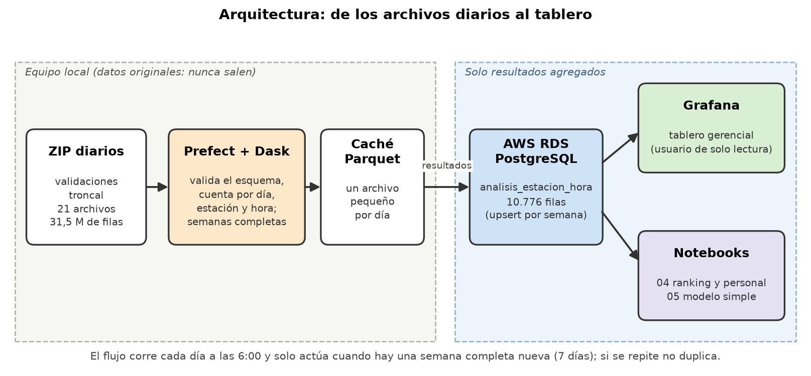

# Proyecto Big Data: TransMilenio (troncal)

Proyecto del curso **Herramientas de Big Data** (Maestría en Analítica). Autores: Juan Pablo Sánchez, William Caro y Leidy Simijaca.

**Pregunta del proyecto:** ¿Qué estaciones de la troncal de TransMilenio requieren refuerzo de personal de apoyo para ordenar el ingreso de usuarios, según su demanda por franja horaria?

**Datos:** validaciones de entrada del componente troncal, 21 días de 2026 (3 al 16 de agosto y 14 al 20 de septiembre): 31,5 millones de filas, 1,98 GB en ZIP y 9,6 GB en CSV. Fuente: [Portal de Datos Abiertos de TransMilenio](https://datosabiertos-transmilenio.hub.arcgis.com/). Los datos originales no están en este repositorio ni en AWS.

**Metodología:** CRISP-DM. El documento del trabajo (formato IEEE) se entrega aparte; este repositorio contiene el código, los notebooks y las evidencias.

## Resultado en una línea

En la punta de la mañana requieren refuerzo, en este orden, Portal Américas, Portal Suba, Portal Sur, Cabecera Usme y Portal Norte; en la de la tarde, Calle 100 y Portal Norte. Se recomienda un esquema de turnos continuos (53 personas fijas y 219 turnos variables de 4 horas por día) con un piloto de campo. El resumen con todas las cifras está en [`docs/resultados_clave.md`](docs/resultados_clave.md).

## Dónde está cada punto de la rúbrica

| Punto | Qué | Dónde |
|---|---|---|
| a, b, c | Datos, objetivo, unidad de análisis, EDA, análisis preliminar e información adicional | Notebooks `01`, `02` y `03`; `docs/decisiones_limpieza.csv` |
| d | Flujo recurrente y escalable con Prefect | `src/pipeline_transmilenio.py`; evidencias en `docs/evidencias/prefect_*.jpg` y `docs/evidencias/flujo_cargas_por_semana.md` |
| e | Dask con varias configuraciones de workers y memoria | Notebook `01`; `docs/benchmark_dask.csv` |
| f | Base de datos en AWS (solo resultados) | Tabla `analisis_estacion_hora` en RDS PostgreSQL; diagrama en `docs/diagrama_er_analisis_estacion_hora.png` |
| g | Visualización gerencial en Grafana | `grafana/dashboard.json`, `docker-compose.yml`; capturas en `docs/evidencias/grafana_*.png` |
| h | Conclusiones | Notebook `04` (lectura del paso 5 y conclusiones); `docs/resultados_clave.md` |
| i, j, k | Documento IEEE con resultados, fases y evidencias | Se entrega aparte (documento compartido) |
| l | Notebooks y scripts en GitHub | Este repositorio |

## Notebooks

| Notebook | Contenido |
|---|---|
| `01_inventario_y_carga_dask` | Inventario de los 21 archivos, conversión a Parquet y comparación pandas / Dask con varias configuraciones |
| `02_exploracion_y_limpieza` | Columnas, vacíos, calidad y decisiones de limpieza |
| `03_eda_demanda_y_patrones` | **El EDA**: días, franjas, estaciones, accesos, perfiles, ida y vuelta, correlaciones e hipótesis |
| `04_ranking_y_personal_de_apoyo` | Responde la pregunta: umbral y ventana de refuerzo, ranking por franja, tres propuestas de personal (A, B y C), plan por estación, piloto de campo y uso de la holgura de los turnos |
| `05_modelo_simple` | Modelo simple: lee la tabla de AWS, validación temporal, líneas base y un modelo sencillo |
| `anexo_teorema_limite_central` | Verificación del Teorema del Límite Central con la hora de la validación |

Los notebooks se pueden ver ya ejecutados en GitHub; si alguno tarda en cargar, se abre en [nbviewer](https://nbviewer.org/github/Juansanm21/transmilenio-perfiles-demanda/tree/v2/notebooks/).

## Arquitectura



```
ZIP diarios → Dask (Parquet) → limpieza y EDA (notebooks 01 a 03: fija las reglas y los parámetros) → [Prefect + Dask: aplica las reglas a los ZIP nuevos] → tabla analisis_estacion_hora (AWS RDS PostgreSQL) → Grafana, análisis de personal y modelo simple
```

- `src/pipeline_transmilenio.py`: flujo de Prefect. Cuando hay una **semana completa** (7 días) que aún no está en la base, la procesa con Dask, calcula el ranking y carga el resultado con *upsert* (si se repite, no duplica). Si no hay semana nueva, termina sin hacer nada.
- Tabla única en AWS: `analisis_estacion_hora`, una fila por semana × estación × hora, con el análisis incluido (ranking, ventana de refuerzo, personas en el pico). Hay 10.776 filas de tres semanas. **Solo resultados agregados**: nunca validaciones individuales ni tarjetas.
- `grafana/dashboard.json` y `docker-compose.yml`: tablero conectado a AWS con un usuario de solo lectura.

## Cómo ver el tablero

- **Sin instalar nada:** las capturas del tablero con datos reales están en [`docs/evidencias`](docs/evidencias) (punta de la mañana y de la tarde de la semana del 14 de septiembre).
- **En vivo:** `docker compose up -d` y abrir http://localhost:3000. Necesita las credenciales de solo lectura de la base, que se entregan por aparte y no están en el repositorio (ver `.env.example`).

## Estructura

```
├── notebooks/            el análisis, un notebook por fase
├── src/                  flujo de Prefect (pipeline_transmilenio.py)
├── grafana/              tablero (dashboard.json) y su configuración
├── docker-compose.yml    Grafana local
├── data/                 NO se sube a GitHub: raw/ (originales) y processed/ (resultados y caché)
└── docs/                 figuras (figs/), evidencias (evidencias/), plan por estación y tablas de decisiones
```

## Cómo ejecutar

```bash
python -m venv venv
source venv/Scripts/activate        # Git Bash en Windows
pip install -r requirements.txt
cp .env.example .env                # llenar con los datos de la base (nunca se suben)
```

Flujo de Prefect (con el entorno activo y los archivos en `data/raw/validaciones_troncal`):

```bash
python src/pipeline_transmilenio.py                          # una corrida
python src/pipeline_transmilenio.py --fecha-corte 2026-08-09 # simula que solo llegaron los archivos hasta esa fecha
python src/pipeline_transmilenio.py --workers 2 --memoria 4GB # otra configuración de Dask
python src/pipeline_transmilenio.py --servir                 # lo deja programado (todos los días a las 6:00)
```

## Reglas del proyecto

- Nunca se sube a AWS ni a GitHub el dataset original: solo resultados.
- Credenciales solo en `.env` (nunca en el código).
- Cada notebook explica qué hace cada celda y deja evidencia para el documento.
